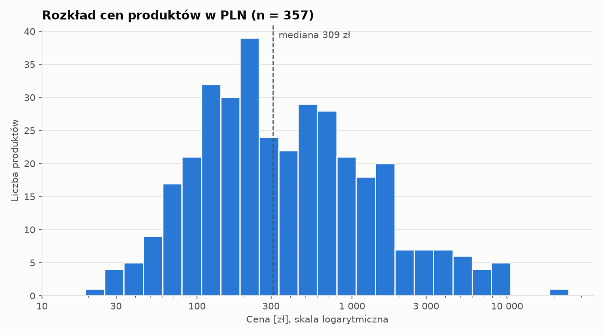
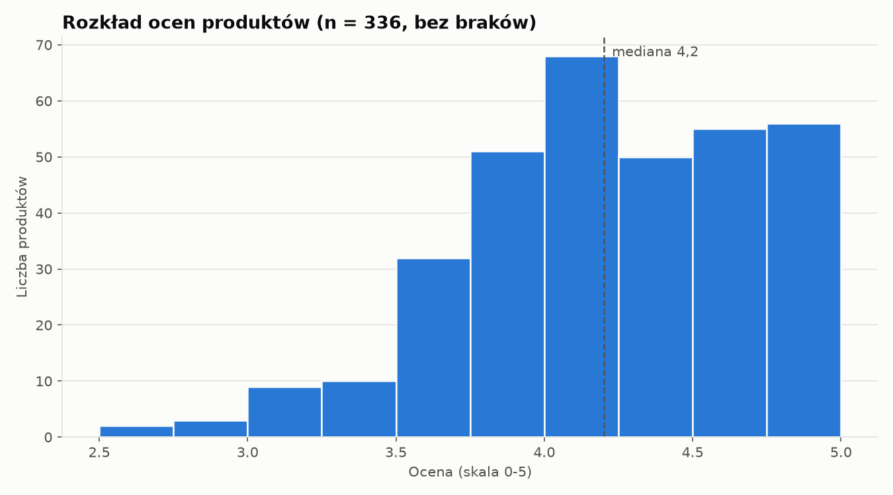
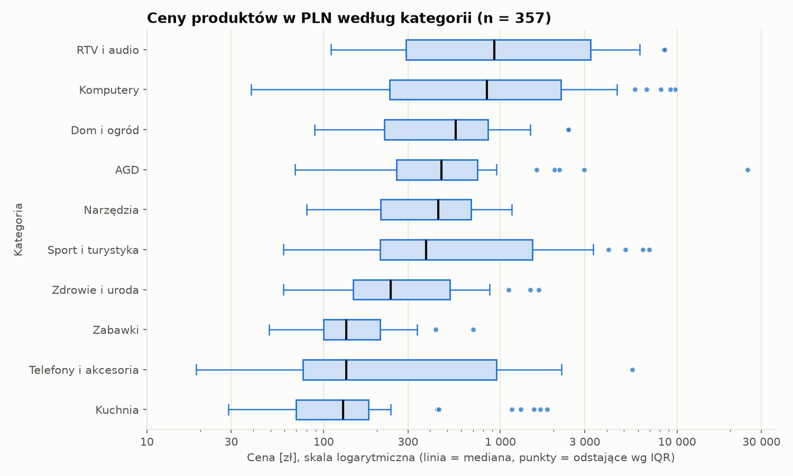
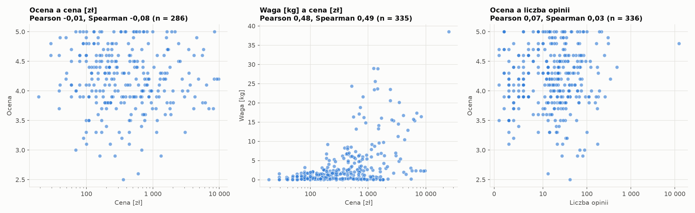

# Statystyki opisowe i wykresy

Źródło: `output/okno.csv` (420 rekordów). Raport generuje `python analiza/statystyki.py`.

## 1. Wybór próby: dlaczego ceny osobno według walut

Ceny występują w trzech walutach: PLN (357), EUR (38) i USD (25). Nie
przeliczamy ich kursem, bo serwis jest fikcyjny i nie ma kursu źródłowego: każdy przyjęty kurs
byłby arbitralnym założeniem, które zmieniłoby wszystkie statystyki. Cenę analizujemy więc
**osobno dla PLN** (357 rekordów, 85.0% katalogu), a EUR i USD
opisujemy tylko tabelą statystyk opisowych: próby 38 i 25 są za małe na
wykresy według kategorii (10 kategorii, średnio kilka rekordów na kategorię) i na wiarygodne
korelacje. Cechy niezwiązane z walutą (ocena, waga, wymiary, stany, czasy) liczymy na
wszystkich 420 rekordach. Koszt dostawy: waluty dostawy w danych to
PLN (420).

## 2. Statystyki opisowe cen (osobno według walut)

| cecha | n | średnia | mediana | moda | Q1 | Q3 | min | max | odch. std. |
|---|---|---|---|---|---|---|---|---|---|
| cena PLN [zł], n=357 | 357 | 931.72 | 309 | 79, 99, 129 | 149 | 849 | 19 | 24999 | 1952.76 |
| cena EUR [€], n=38 | 38 | 160.86 | 60.99 | 6.99, 10.99, 13.99 … | 23.49 | 235.24 | 6.99 | 786.99 | 199.25 |
| cena USD [$], n=25 | 25 | 225.07 | 83.99 | 45.99, 83.99 | 45.99 | 165.99 | 6.99 | 1769.99 | 430.1 |

Cena PLN: średnia 931.72 zł wobec mediany 309.00 zł,
skośność 6.73. Rozkład jest silnie prawoskośny (średnia ciągnięta w górę przez kilka
drogich produktów), dlatego do opisu „typowej” ceny używamy mediany i kwartyli, a wykresy
rysujemy w skali logarytmicznej.

## 3. Statystyki opisowe pozostałych cech liczbowych (wszystkie rekordy)

| cecha | n | średnia | mediana | moda | Q1 | Q3 | min | max | odch. std. |
|---|---|---|---|---|---|---|---|---|---|
| ocena (0-5) | 336 | 4.2 | 4.2 | 5 | 3.9 | 4.6 | 2.5 | 5 | 0.51 |
| liczba opinii | 420 | 58.66 | 14 | 0 | 3 | 31 | 0 | 12480 | 609.65 |
| gwarancja (mies.) | 399 | 24.6 | 24 | 24 | 24 | 24 | 12 | 60 | 10.68 |
| waga (kg) | 395 | 3.35 | 1.46 | 0.06 | 0.36 | 3.15 | 0.02 | 38.5 | 5.41 |
| szerokość (cm) | 420 | 30.59 | 28 | 5 | 14 | 41 | 3 | 116 | 22.28 |
| wysokość (cm) | 420 | 31.19 | 21 | 2 | 8 | 37 | 1 | 191 | 35.03 |
| głębokość (cm) | 420 | 27.37 | 15 | 7 | 7 | 27.25 | 1 | 203 | 40.48 |
| stan magazynowy (szt.) | 420 | 79.5 | 52.5 | 0 | 2 | 144.5 | 0 | 250 | 82.28 |
| czas dostawy (dni) | 420 | 5.46 | 2.5 | 2 | 2 | 4 | 1 | 30 | 6.98 |
| koszt dostawy | 420 | 13.58 | 9.99 | 0 | 0 | 14.99 | 0 | 149 | 18.99 |
| zwrot (dni) | 420 | 41.59 | 30 | 30 | 30 | 30 | 14 | 100 | 30.25 |

Uwagi: `n` mniejsze niż 420 oznacza braki (ocena, gwarancja, waga). Moda cech ciągłych
(waga, wymiary) bywa przypadkowa (przy remisach pokazano do trzech wartości), więc do opisu
tych cech służą mediana i kwartyle.
Kolumny wymiarów (szerokość, wysokość, głębokość) odpowiadają kolejności liczb w tekście
serwisu; nazwy ustalono po analizie rozkładów, patrz `kontrola_jakosci.md`, sekcja 7.

## 4. Wykresy

### Histogram ceny PLN

W skali logarytmicznej rozkład jest szeroki (min 19 zł,
max 24 999 zł, mediana 309 zł) z
długim prawym ogonem i bez jednego wyraźnego szczytu (kilka sąsiednich przedziałów o
podobnej liczności), co wiąże się z mieszaniem kategorii o różnych poziomach cen (box-plot
niżej).

### Histogram oceny

Oceny skupiają się wokół mediany 4.2 (Q1 3.9,
Q3 4.6); 84 produktów nie ma oceny i
nie jest uwzględnionych.

### Box-plot ceny PLN według kategorii

Mediany cen według kategorii (rosnąco):

| kategoria | n | mediana | min | max |
|---|---|---|---|---|
| Kuchnia | 37 | 129 | 29 | 1839.99 |
| Telefony i akcesoria | 40 | 134 | 19 | 5579 |
| Zabawki | 32 | 134 | 49 | 699.99 |
| Zdrowie i uroda | 32 | 239 | 59 | 1649 |
| Sport i turystyka | 35 | 379 | 59 | 6959.99 |
| Narzędzia | 40 | 444.99 | 79.99 | 1159 |
| AGD | 34 | 464 | 69 | 24999 |
| Dom i ogród | 37 | 559.99 | 89 | 2439.99 |
| Komputery | 36 | 839.5 | 39 | 9719 |
| RTV i audio | 34 | 924.5 | 109.99 | 8469 |

Najniższą medianę ma „Kuchnia” (129 zł), najwyższą „RTV i audio”
(924.495 zł), czyli 7.2× więcej. Kategoria
wyjaśnia 23.5% wariancji log10(ceny) (eta², ANOVA jednoczynnikowa); dla
porównania kwadrat Spearmana ceny z wagą to 0.243. Pudełka
kategorii nakładają się, więc sama kategoria nie wyznacza ceny.

## 5. Korelacje

Współczynniki Pearsona (zależność liniowa, wrażliwy na odstające) i Spearmana (zależność
monotoniczna, oparty na rangach). „Próg istotności” to przybliżony próg |r| ≈ 1,96/√(n−1)
dla poziomu 5%; wartość poniżej progu jest nieodróżnialna od zera.

| para | n | Pearson | Spearman | siła (wg Spearmana) | próg istotności 5% (≈) | oczekiwany znak | istotna |
|---|---|---|---|---|---|---|---|
| cena PLN – ocena | 286 | -0.01 | -0.08 | pomijalna | 0.12 | dodatnia | nie |
| cena PLN – waga_kg | 335 | 0.48 | 0.49 | umiarkowana | 0.11 | dodatnia | tak |
| liczba_opinii – ocena (wszystkie) | 336 | 0.07 | 0.03 | pomijalna | 0.11 | dodatnia | nie |
| liczba_opinii – ocena (bez max. liczby opinii) | 335 | 0.05 | 0.02 | pomijalna | 0.11 | dodatnia | nie |
| cena PLN – waga_kg (rangi w obrębie kategorii) | 335 | 0.42 | 0.42 | umiarkowana | 0.11 | dodatnia | tak |
| cena PLN – stan_magazynowy_szt | 357 | -0.05 | -0.03 | pomijalna | 0.1 | ujemna | nie |
| cena PLN – liczba_opinii | 357 | -0.02 | -0.06 | pomijalna | 0.1 | ujemna | nie |

### Komentarz

- **cena PLN – ocena**: Spearman -0.080 (pomijalna, ujemna, nieistotna przy n=286), Pearson -0.006. Wynik niezgodny lub niewykazany (hipoteza: zależność dodatnia).
- **cena PLN – waga_kg**: Spearman 0.493 (umiarkowana, dodatnia, istotna przy n=335), Pearson 0.478. Wynik zgodny z intuicją (hipoteza: zależność dodatnia).
- **liczba_opinii – ocena (wszystkie)**: Spearman 0.031 (pomijalna, dodatnia, nieistotna przy n=336), Pearson 0.068. Wynik niezgodny lub niewykazany (hipoteza: zależność dodatnia).
- **liczba_opinii – ocena (bez max. liczby opinii)**: Spearman 0.025 (pomijalna, dodatnia, nieistotna przy n=335), Pearson 0.048. Wynik niezgodny lub niewykazany (hipoteza: zależność dodatnia).
- **cena PLN – waga_kg (rangi w obrębie kategorii)**: Spearman 0.420 (umiarkowana, dodatnia, istotna przy n=335), Pearson 0.421. Wynik zgodny z intuicją (hipoteza: zależność dodatnia).
- **cena PLN – stan_magazynowy_szt**: Spearman -0.033 (pomijalna, ujemna, nieistotna przy n=357), Pearson -0.046. Wynik niezgodny lub niewykazany (hipoteza: zależność ujemna).
- **cena PLN – liczba_opinii**: Spearman -0.062 (pomijalna, ujemna, nieistotna przy n=357), Pearson -0.022. Wynik niezgodny lub niewykazany (hipoteza: zależność ujemna).

**Interpretacja.** Dane są fikcyjne i generowane losowo, więc brak korelacji tam, gdzie
rzeczywisty rynek miałby zależność, jest wynikiem do omówienia, a nie wadą parsera
(odczyt niezależny w `kontrola_jakosci.md`: 0 niezgodności).

- **Bez zależności** (5 z 7 par: cena PLN – ocena; liczba_opinii – ocena (wszystkie); liczba_opinii – ocena (bez max. liczby opinii); cena PLN – stan_magazynowy_szt; cena PLN – liczba_opinii): współczynniki
  są poniżej progu istotności. Cena nie niesie informacji o ocenie (Spearman
  -0.08), a liczba opinii nie niesie informacji o ocenie
  (0.03). Na rynku spodziewalibyśmy się dodatniej zależności ceny od
  jakości i liczby opinii od popularności; jej brak wskazuje, że generator losował te cechy
  niezależnie.
- **Cena a waga**: Spearman 0.49 (n=335) jest istotny
  i dodatni, więc generator wiązał wagę z ceną lub z kategorią. Po usunięciu efektu kategorii
  (rangi w obrębie kategorii) zależność wynosi 0.42
  (próg ≈ 0.11), czyli
  pozostaje istotna. Merytorycznie
  ma to sens: cięższe towary (AGD, sprzęt sportowy, dom i ogród) są droższe, ale RTV i
  elektronika bywają lekkie i drogie, stąd tylko umiarkowana siła.
- **Rekord z największą liczbą opinii** zmienia Pearsona liczby opinii z oceną z
  0.068 (z rekordem) na 0.048 (bez), a Spearmana
  z 0.031 na 0.025: wniosek nie zależy od
  tego rekordu.
